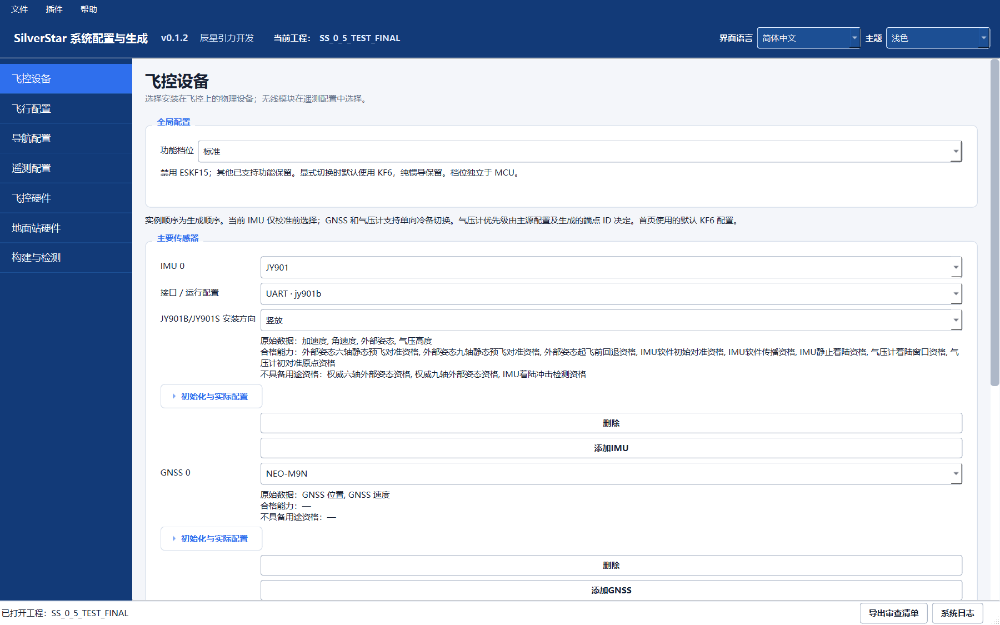
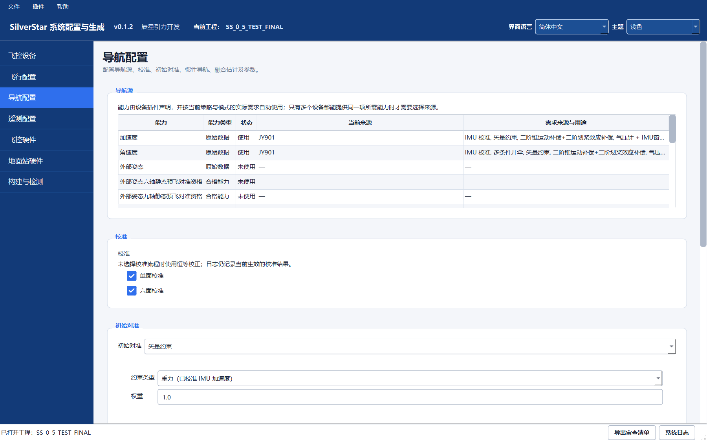
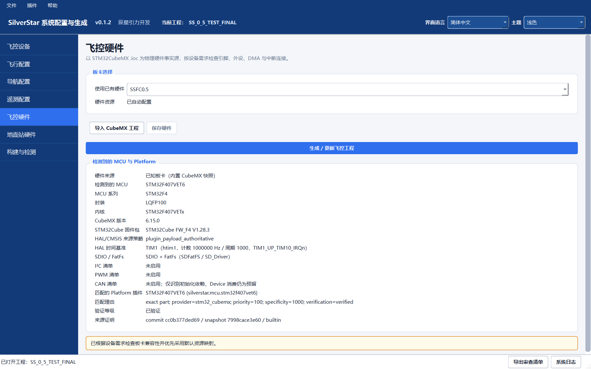
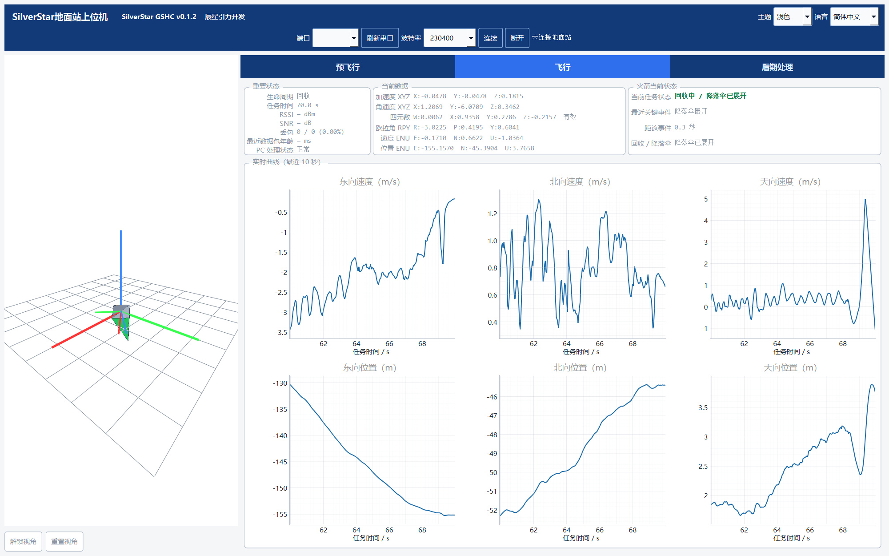
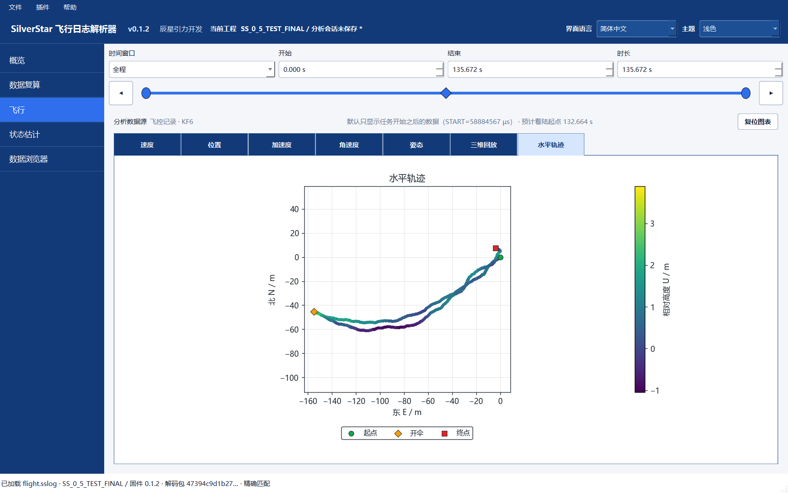
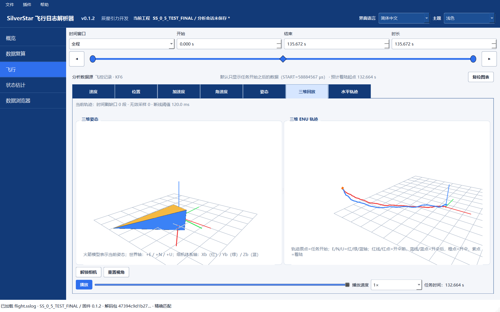
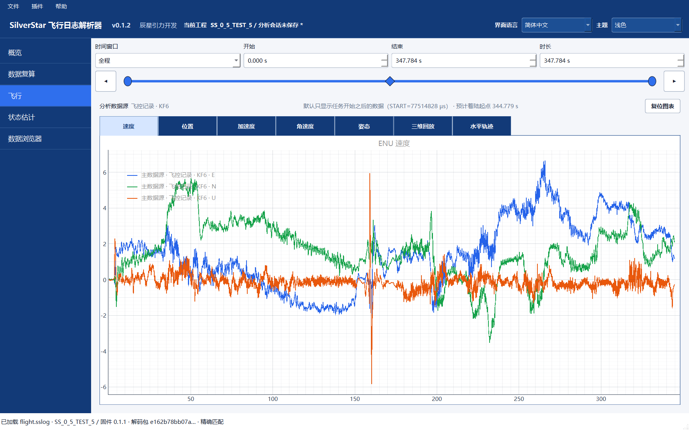

# SilverStar

[简体中文](README.md) · English

An open-source toolchain for avionics development on unguided sounding rockets: configure hardware and generate projects with **SCG**, monitor ground telemetry with **GSHC**, and inspect recorded logs with **FLP**.

**Stable release: [v0.1.2 · 2026-10-12](https://github.com/aleistercrowleybeast666/SilverStar/releases/tag/v0.1.2)** · [Download for Windows](https://github.com/aleistercrowleybeast666/SilverStar/releases/download/v0.1.2/SilverStar_0_1_2_Windows_Portable.zip) · [Sample logs](docs/public/examples/README.md#english) · [Documentation](docs/public/README.md) · [Issues](https://github.com/aleistercrowleybeast666/SilverStar/issues)

## Download and try it

The portable package runs on **64-bit Windows 10/11** without a separate Python installation. Extract the complete archive and launch `SCG.exe`, `GSHC.exe`, or `FLP.exe`. All three share `_internal`; keep the directory structure intact.

1. **Explore configuration:** open SCG to browse devices, navigation, telemetry, and hardware settings. Generate projects into a writable folder outside the package. Building firmware also requires Arm GNU, Make, and the appropriate hardware resources.
2. **Explore the ground station:** open GSHC while disconnected to browse the interface. Live data requires a matching ground station and communication link.
3. **Open real recorded data:** download main example `000062` and its exact `.ssdecoder` from the [sample page](docs/public/examples/README.md#english). Open the log in FLP, select that decoder, and choose **Recorded** to inspect the original data, mission summary, and charts. Historical record `000028` provides an independent reference. No connected hardware is needed.

GSHC defaults to `D:/SilverStar_GSHC_Data`. If that drive is unavailable, or you prefer another location, open PowerShell in the portable package folder:

```powershell
$env:SILVERSTAR_GSHC_DATA_ROOT = Join-Path $env:LOCALAPPDATA 'SilverStar_GSHC_Data'
& '.\GSHC.exe'
```

<details>
<summary>Verify the v0.1.2 download</summary>

File: `SilverStar_0_1_2_Windows_Portable.zip`, **220688183 bytes**. Its SHA-256 matches the value published in the [Release](https://github.com/aleistercrowleybeast666/SilverStar/releases/tag/v0.1.2):

```text
3330d83f49a2665c9052ad624719c22c484dde84507b02024868ded4f6ecce8e
```

</details>

## The three tools

| Tool | What it does | Guide |
|---|---|---|
| **SCG** · System Configuration & Generation | Select sensors, navigation algorithms, telemetry links, and mission parameters; check pins and peripherals; generate STM32 Flight/Ground projects and matching decoders | [SCG](docs/public/SCG/README.md) |
| **GSHC** · Ground Station Host Computer | Receive AIR M0 telemetry, display readiness, 3D attitude, trajectories, and mission events; record sessions and export data, charts, and attitude animations | [GSHC](docs/public/GSHC/README.md) |
| **FLP** · Flight Log Processor | Open exact log/decoder pairs, check integrity, inspect trajectories, curves, and filter internals; recompute, compare, and export analysis results | [FLP](docs/public/FLP/README.md) |

### SCG: configuration to generated projects

SCG offers Full, Standard, Lightweight, and Minimal configuration tiers. Configure devices and interfaces, mounting directions, calibration/initial alignment, navigation parameters, and telemetry tasks. Navigation components include Pure INS, SF6, KF6, and ESKF15. Devices and algorithms use declarative plugins. FCCG is SCG's former name; the `silverstar_fccg` package and older entry points remain compatible.

**Devices and configuration tiers:** FINAL's actual configuration includes JY901, NEO-M9N, and their interface options.



**Navigation configuration:** select sources according to project capabilities and configure calibration, initial alignment, and fusion parameters.



**Project generation:** identify the board and MCU, check CubeMX hardware resources, then generate/update the Flight project and matching decoder. The image shows the entry point and hardware information; no generation or flashing was performed.



### GSHC: flight monitoring, 3D attitude, and navigation curves

GSHC brings preflight preparation, flight monitoring, and post-processing into one interface: inspect readiness and mission events, view 3D attitude and navigation data, record JSONL sessions, and export summaries, data, charts, and attitude animations.

The official v0.1.2 Flight page below shows 3D attitude alongside E/N/U velocity and position curves from `000062` Recorded data, covering about 60–70 seconds. This is an offline display demonstration with no connected device; normal live monitoring receives ground-station telemetry.



### FLP: trajectories, curves, and offline analysis

FLP opens original logs with their exact `.ssdecoder` and displays **Recorded** integrity, mission events, position/velocity/acceleration/angular-rate/attitude channels, and filter internals. Switch between full-mission and local time windows; view attitude and the ENU path together in 3D replay. Offline recomputation, What-if, and primary/secondary comparisons use their own analysis sources.

Exports can include an overview, diagnostics, events, CSV, chart/3D-trajectory PNGs, and flight-replay GIFs for further analysis and sharing. The images below all use original **Recorded · KF6**, without replacing recorded values with recomputation.

**Horizontal trajectory · main example `000062`:** color indicates relative height; markers identify the start, deployment event, and end.



**3D attitude and trajectory · `000062`:** inspect attitude, the ENU path, and event positions within the mission range.



**Velocity curves · independent reference `000028`:** E/N/U components across a mission of about 347.784 seconds. This case uses the TEST_5 decoder and is opened separately from FINAL.



The [illustrated walkthrough](docs/public/V0_1_2_WALKTHROUGH.md#english) includes operating steps, `000062`'s full-mission velocity chart, and the provenance of both recordings. The screenshots use official **v0.1.2** program files. These historical bench, handheld, and thrown-object records demonstrate the tools' workflow; they are not rocket flight validation.

## Samples and documentation

The [hardware-free tour and sample downloads](docs/public/examples/README.md#english) provide FINAL's `000062` main example and TEST_5's `000028` independent reference. Each compact archive contains only the original log and its decoder, with checksums and version provenance. Download samples separately; they are not included in the Windows portable archive.

FLP requires an original `.BIN` / `.sslog` and a `.ssdecoder` matching its Descriptor identity. Missing or mismatched packages produce an error. Recorded means values actually recorded; recomputation and What-if are separate analysis results. Preserve the original log and decoder, and export into a new directory.

| Start here | Contents |
|---|---|
| [Three-tool workflow](docs/public/USER_WORKFLOW.md) | Configuration, generation, ground monitoring, offline analysis, and export |
| [Windows package](docs/public/WINDOWS_PACKAGE.md) | Runtime layout, data locations, and external tools |
| [Documentation index](docs/public/README.md) | Application guides, plugins, APIs, and shared contracts |
| [Support matrix](docs/public/SUPPORT_MATRIX.md) | Hardware combinations, configuration starting points, and verification scope |
| [Navigation implementation](docs/public/algorithms/NAVIGATION_IMPLEMENTATION.md) · [Formula PDF](docs/public/math/navigation-models.pdf) | Implementations, coordinates, notation, and assumptions |
| [Release introduction and tutorial](https://www.kechuang.org/t/92068) | v0.1.2 features and recorded examples |

## Stable release and development

Use the [v0.1.2 Release](https://github.com/aleistercrowleybeast666/SilverStar/releases/tag/v0.1.2) for downloads and the [v0.1.2 tag](https://github.com/aleistercrowleybeast666/SilverStar/tree/v0.1.2) for exact source. Remote `main` uses that version as its baseline and can receive documentation updates. The **0.1.3 development line is unreleased**; the root `VERSION` identifies the checked-out source version.

The [version registry](versions.json) references the root `VERSION` as the sole manually maintained product number. Run `python -B tools/silverstar_version.py` for resolved application, protocol, format and plugin identities. See [version management](docs/public/shared/VERSION_MANAGEMENT.md) for compatibility boundaries.

The configurations tested for v0.1.2 include an STM32F407 flight controller and an STM32F103 serial ground station, with bench, handheld, and thrown-object recordings. These do not establish rocket flight validation. Native USB CDC paths for F103/C071 remain experimental, with restricted normal generation and no completed verification on the corresponding USB hardware. Magnetometer workflows, IEKF, maintenance protocols, and other 0.1.3 work depend on their individual documentation and acceptance status. Android remains a development application with real USB/control gates; DeviceService is a mock-only prototype. Neither is included in the v0.1.2 desktop package.

See the [version and evidence notes](docs/public/shared/VERSIONS_AND_EVIDENCE.md) and [software verification guide](docs/public/SOFTWARE_VERIFICATION.md) for the scope of individual checks.

### Run from source

Download the v0.1.2 source tag for the stable version; development checkouts use their own version and documentation. With Python 3.11+, run from the repository root:

```powershell
python -m venv .venv
.\.venv\Scripts\python.exe -m pip install -e .
.\.venv\Scripts\python.exe SCG.py
.\.venv\Scripts\python.exe GSHC.py
.\.venv\Scripts\python.exe FLP.py
```

Each launch command starts one application. Use `tools/setup_venv.ps1` for test and packaging dependencies. Install the firmware toolchain separately; see the [build guide](docs/public/SCG/BUILD.md).

## Feedback and licensing

Report bugs and suggestions through [GitHub Issues](https://github.com/aleistercrowleybeast666/SilverStar/issues). Include the software version, relevant hardware configuration, reproduction steps, and logs. For log parsing issues, also attach the matching `.ssdecoder`.

Original SilverStar source uses the [Apache License 2.0](LICENSE). Third-party code and dependencies retain their own terms. See [third-party provenance and licenses](docs/public/licenses/README.md) for the SX1280 library's origin, modifications, and unresolved licensing matters.
