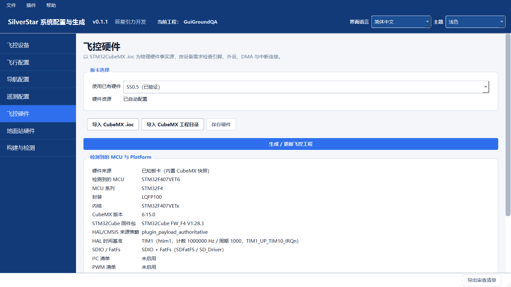
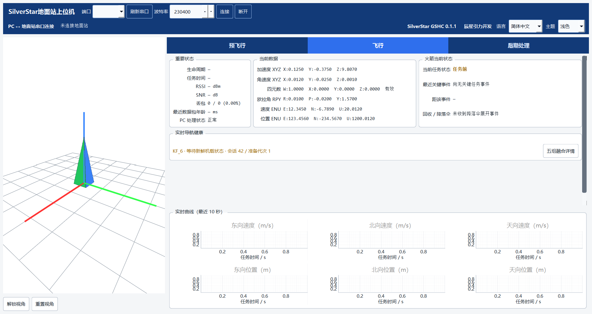
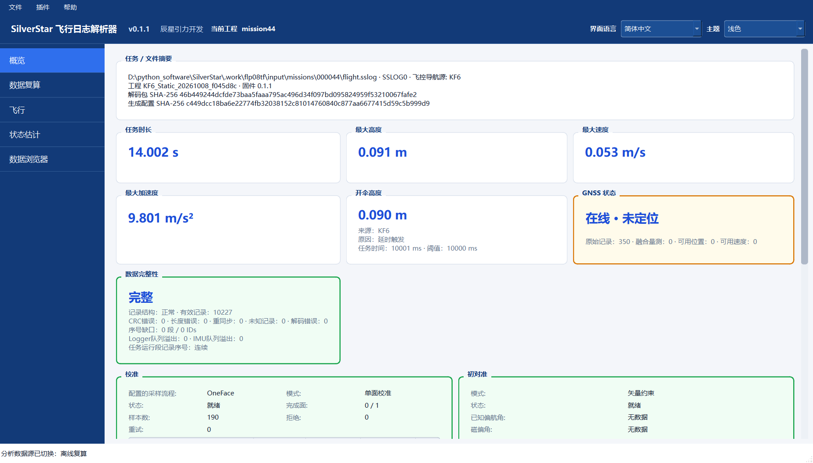

# SilverStar

简体中文 · [English](README.en.md)

面向无控探空火箭航电开发的开源工具链：用 **SCG** 配置硬件与生成工程，用 **GSHC** 查看地面遥测，用 **FLP** 阅读和分析记录日志。

**稳定发布：[v0.1.2 · 2026-10-12](https://github.com/aleistercrowleybeast666/SilverStar/releases/tag/v0.1.2)** · [下载 Windows 便携包](https://github.com/aleistercrowleybeast666/SilverStar/releases/download/v0.1.2/SilverStar_0_1_2_Windows_Portable.zip) · [示例日志](docs/public/examples/README.md) · [使用文档](docs/public/README.md) · [问题反馈](https://github.com/aleistercrowleybeast666/SilverStar/issues)

## 下载与快速体验

便携包适用于 **Windows 10/11 64 位**，无需安装 Python。完整解压后运行 `SCG.exe`、`GSHC.exe` 或 `FLP.exe`；三个程序共用 `_internal`，请保留目录结构。

1. **配置项目**：打开 SCG，浏览设备、导航、遥测和硬件配置。生成工程时选择包外的可写项目目录；编译固件另需 Arm GNU、Make，以及对应的硬件资源。
2. **浏览地面站**：打开 GSHC，可在未连接状态下浏览界面。实时数据需要匹配的地面站与通信链路。
3. **带数据体验**：从[示例页](docs/public/examples/README.md)下载静态台架记录 `000044` 和对应的 `.ssdecoder`，在 FLP 中打开日志并选择该解码包，查看 **Recorded** 数据、任务摘要与图表。记录 `000045` 可作第二个例子；无需连接硬件。

GSHC 默认数据目录为 `D:/SilverStar_GSHC_Data`。没有 D 盘或希望另选位置时，可在便携包目录打开 PowerShell：

```powershell
$env:SILVERSTAR_GSHC_DATA_ROOT = Join-Path $env:LOCALAPPDATA 'SilverStar_GSHC_Data'
& '.\GSHC.exe'
```

<details>
<summary>v0.1.2 下载校验</summary>

文件：`SilverStar_0_1_2_Windows_Portable.zip`，大小 **220688183 字节**。SHA-256 与 [Release](https://github.com/aleistercrowleybeast666/SilverStar/releases/tag/v0.1.2) 公布值一致：

```text
3330d83f49a2665c9052ad624719c22c484dde84507b02024868ded4f6ecce8e
```

</details>

## 三款工具

| 工具 | 可以做什么 | 使用说明 |
|---|---|---|
| **SCG** · System Configuration & Generation | 配置传感器、导航、遥测与任务；检查引脚和外设资源；生成 STM32 Flight/Ground 工程及配套解码包 | [SCG 指南](docs/public/SCG/README.md) |
| **GSHC** · Ground Station Host Computer | 接收 AIR M0 遥测，查看设备准备状态、姿态、轨迹和任务事件；记录会话并导出图表与表格 | [GSHC 指南](docs/public/GSHC/README.md) |
| **FLP** · Flight Log Processor | 使用精确配对的日志和解码包检查记录完整性，查看轨迹与滤波器数据，进行离线复算、结果比较和导出 | [FLP 指南](docs/public/FLP/README.md) |

SCG 提供完整、标准、轻量和最简四种配置档位，导航组件包括 Pure INS、SF6、KF6 和 ESKF15。设备与算法采用声明式插件组织。FCCG 是 SCG 的历史名称，`silverstar_fccg` 包名和旧入口继续兼容。

下面复用仓库中保存的**真实历史界面截图**：画面来自 v0.1.1 阶段，已收录于 v0.1.2 源码标签，未作为 v0.1.2 或 0.1.3 的新截图。各图日期、数据性质与来源见[素材说明](docs/public/examples/README.md#截图来源)。

### SCG：从配置到工程

飞控硬件页展示板卡、CubeMX 导入与资源检查入口。截图日期：2026-10-01，示例配置工程。



### GSHC：地面遥测与状态

飞行页集中展示姿态、导航数据、任务状态与曲线。设备准备状态以实际回报为准，ACK 仅表示命令应答，不等于 READY。截图日期：2026-10-01，**未连接设备，数值由界面测试构造**。



### FLP：日志阅读与离线分析

记录 `000044` 的任务摘要与完整性信息。截图日期：2026-10-08，**真实静态台架日志，画面选择的是离线复算源**；重新打开时可先选择 Recorded 查看原记录。



## 示例与文档

[无需硬件体验与示例下载](docs/public/examples/README.md)提供两份已提交的历史台架日志和精确匹配解码包，固定指向 v0.1.2 源码标签。这些文件需单独下载，不在 Windows 便携包内；它们记录的是旧版固件，不是 v0.1.2 的飞行测试。

FLP 要求原始 `.BIN` / `.sslog` 与 Descriptor 身份匹配的 `.ssdecoder`，缺包或身份不符会报告错误。Recorded 表示实际记录值；复算与 What-if 是独立分析结果。请保留原日志和解码包，将导出写入新目录。

| 从这里开始 | 内容 |
|---|---|
| [三工具操作路线](docs/public/USER_WORKFLOW.md) | 配置、生成、地面监测、离线分析与导出 |
| [Windows 包说明](docs/public/WINDOWS_PACKAGE.md) | 运行目录、数据位置和外部工具 |
| [公共文档索引](docs/public/README.md) | 各应用使用说明、插件、API 与共享契约 |
| [支持矩阵](docs/public/SUPPORT_MATRIX.md) | 硬件组合、配置起点与验证范围 |
| [导航实现](docs/public/algorithms/NAVIGATION_IMPLEMENTATION.md) · [公式 PDF](docs/public/math/navigation-models.pdf) | 算法实现、坐标、符号与假设 |
| [发布介绍与教程](https://www.kechuang.org/t/92068) | v0.1.2 功能介绍和实测案例 |

## 稳定发布与开发

下载使用以 [v0.1.2 Release](https://github.com/aleistercrowleybeast666/SilverStar/releases/tag/v0.1.2) 为准，精确源码由 [v0.1.2 标签](https://github.com/aleistercrowleybeast666/SilverStar/tree/v0.1.2) 固定。远端 `main` 以该版本为基线，文档可继续更新。**0.1.3 开发线尚未发布**；源码版本由根 `VERSION` 标识。

v0.1.2 的实测配置包括 STM32F407 飞控和 STM32F103 串口地面站，覆盖台架、手持与抛体采集，尚不构成火箭飞行验证。原生 USB CDC 的 F103/C071 路径仍属实验范围，普通生成入口受限，尚未完成对应 USB 硬件的上板验证。磁力计工作流、IEKF、维护协议等 0.1.3 开发内容以各自说明和验收状态为准。Android 保持开发版及真实 USB/控制门禁，DeviceService 是 mock-only 原型；两者均不在 v0.1.2 桌面包内。

更详细的[版本与证据边界](docs/public/shared/VERSIONS_AND_EVIDENCE.md)和[软件验证说明](docs/public/SOFTWARE_VERIFICATION.md)保留各项检查的范围。软件检查不替代硬件验证；项目的 Power of Ten 检查是 F Prime-inspired 适配，关键合同人工审查仍为 NOT PROVEN。

### 从源码运行

稳定源码请从 v0.1.2 标签下载；开发检出使用其自身版本和文档。要求 Python 3.11+，在仓库根目录运行：

```powershell
python -m venv .venv
.\.venv\Scripts\python.exe -m pip install -e .
.\.venv\Scripts\python.exe SCG.py
.\.venv\Scripts\python.exe GSHC.py
.\.venv\Scripts\python.exe FLP.py
```

每条启动命令分别运行一个应用。需要测试与打包依赖时使用 `tools/setup_venv.ps1`；固件编译工具链单独安装，见[构建说明](docs/public/SCG/BUILD.md)。

## 反馈与许可

欢迎通过 [GitHub Issues](https://github.com/aleistercrowleybeast666/SilverStar/issues) 提交问题和建议。请附软件版本、相关硬件配置、复现步骤与日志；日志解析问题请同时附上匹配的 `.ssdecoder`。

原创 SilverStar 源码使用 [Apache License 2.0](LICENSE)。第三方代码和依赖保留各自条款；SX1280 库来源、修改与尚未解决的许可事项见[第三方来源与许可](docs/public/licenses/README.md)。
