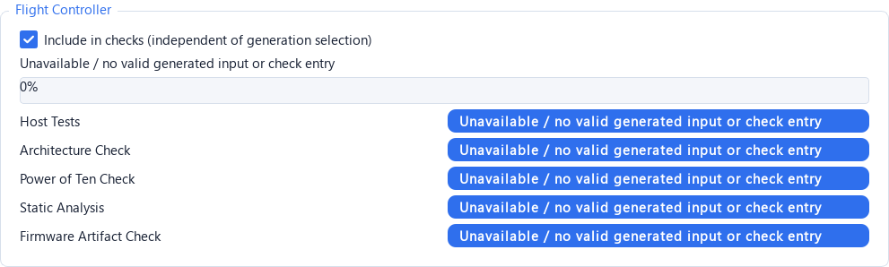
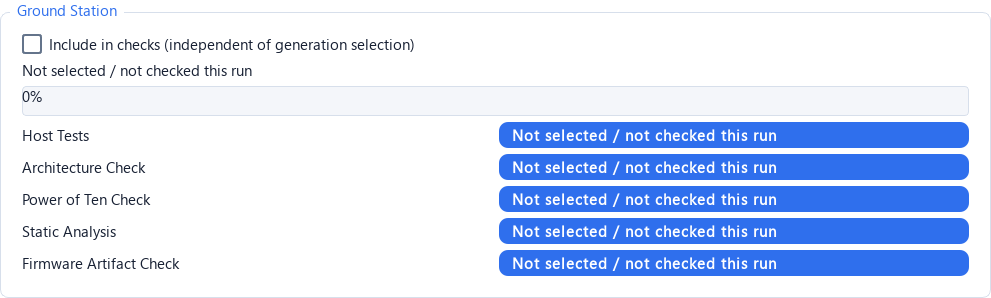
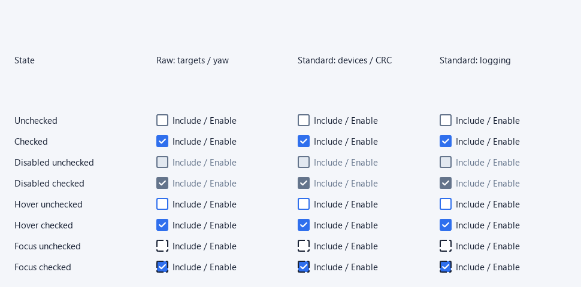
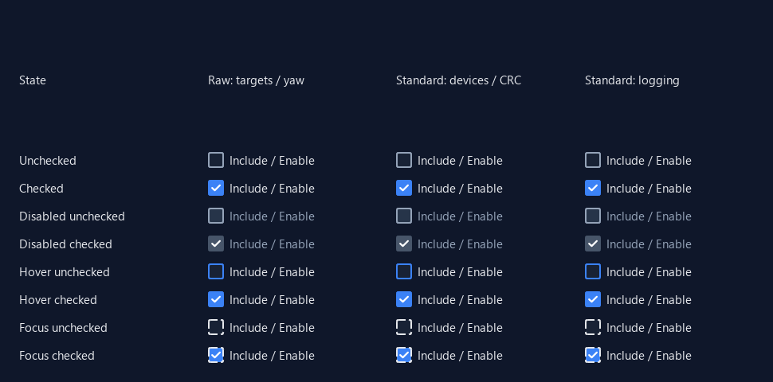

# SCG checkbox visibility — 2026-10-09

The Build & Validation Flight/Ground check selectors now have visible square
indicators in both themes. Every QCheckBox uses the same indicator styling,
including controls without an object name. Disabled checked controls retain a
white tick on a contrasting fill; keyboard focus has a dashed square boundary.
No control construction, selection default, signal connection, model policy,
radio button, disclosure button or firmware template changed.

Base: `1534120e02a28d98b83e7d7cdc99849d52189d67`.
Independent branch: `fix/scg-checkbox-indicators-20261009`.
Only product change: `src/silverstar_fccg/ui/theme.py`.

## Cause and coverage

The previous QSS addressed only `QCheckBox#standardCheckBox::indicator`.
BuildPage creates two unnamed QCheckBox controls, and the alignment editor's
absolute-yaw option is unnamed too. Under the application stylesheet/Fusion
style, these showed text alone when unchecked and a floating tick when checked.
Ordinary StandardCheckBox disabled-checked styling also produced a white tick
on a nearly white surface in the light theme. The log-specific override is now
unnecessary because all disabled checked controls have a contrasting fill.

| Actual controls | Source | Coverage |
| --- | --- | --- |
| Flight/Ground check inclusion | `ui/pages/build.py:123` | Unnamed indicators fixed; initial Flight selected, Ground unselected |
| Absolute yaw | `ui/pages/navigation_alignment.py:46` | Unnamed indicator fixed; actual external-attitude editor screenshot |
| Device, indicator, actuator and storage toggles | `ui/pages/components.py:621` | StandardCheckBox inherits common style |
| Flight actions / modes | `ui/pages/components.py:1288`, `1761` | StandardCheckBox inherits common style |
| Log stream enable / required selections | `ui/pages/components.py:2058` | StandardCheckBox and LockedCheckBox; improved disabled tick |
| AIR CRC | `ui/pages/targets.py:157` | Already named standardCheckBox; common style and actual page screenshot |
| Ground enable / activity LED | `ui/pages/targets.py:312`, `384` | StandardCheckBox inherits common style; LED screenshot |

An isolated default SCG MainWindow contained **57 QCheckBox descendants**:
4 plain QCheckBox, 40 StandardCheckBox and 13 LockedCheckBox. Full inventories
are archived. No checkable model items or checkable group boxes were found.
The checkable CollapsibleSection QToolButton is a disclosure control and remains
unchanged. CRC already opted into the old style; it was not one of the missing
box controls.

## Visual verification






`evidence.zip` includes 22 PNG screenshots: before light/dark at 100%; after
light/dark at 100%, 125%, 150%, 200%; and actual Flight, Ground, AIR CRC,
activity LED, logging table and external-attitude editor in both themes.
Each matrix includes unchecked, checked, disabled unchecked, disabled checked,
hover unchecked/checked and focus unchecked/checked. Matrix hover/focus flags
are supplied to a test-only Qt style option so every state can be displayed at
once. Regression tests separately exercise real Qt Enter/Leave and keyboard
focus events; the actual page screenshots use real production widgets.
All screenshots were generated offscreen in private processes. They were
reviewed for square boundaries, ticks, focus marks, common appearance and
fractional-scale clipping. This is not observation of the user's running window
or a physical multi-monitor DPI transition. Segoe UI was loaded from the system
font file into the screenshot processes because this offscreen Qt installation
does not automatically discover fonts.

## Recorded tests

Python 3.14.0; PySide6 6.10.1; pytest 9.1.1; QT_QPA_PLATFORM=offscreen.
Complete saved logs and the screenshot scripts are in the archive.

* Original base QSS loaded in memory, new render regression unchanged:
  **8 failed, 3 deselected, exit 1**. All raw/standard indicator comparisons fail;
  raw indicator geometry is 14x14 versus the styled 20x20 square. No source file
  was rolled back for this baseline.
* New indicator tests plus theme/settings tests:
  **13 passed, exit 0**, 4.14 seconds. Cover unnamed/renamed/standard controls,
  both themes, enabled/disabled, square-border and tick pixels, hover/focus,
  label click toggling exactly once, Space toggling, disabled rejection,
  LockedCheckBox rejection and independent Flight/Ground selection defaults.
* Selected existing controls and dual-target routing regressions:
  **10 passed, 42 deselected, exit 0**, 57.14 seconds. BuildRunner is mocked in
  the selected routing cases; no firmware build or hardware access occurred.
* Two isolated real-window captures, exit 0: 57-control inventories match,
  Theme_Apply preserves the project dictionary and every checkbox selection
  and enabled state, and initial check selection remains Flight only.
* `git diff --check`: exit 0.

The initial new test harness had offscreen hover/focus interference (4 failures,
then 2 failures); explicit Enter/Leave events and NoFocus during hover capture
made those states deterministic without changing product behavior or weakening
the pixel checks. The first existing-test invocation had a collection error
because the sparse worktree lacked the SCG tools import path. It was rerun with
the auxiliary tools checked out and the app root on PYTHONPATH. The saved error
log is retained. Successful runs have an existing `cache_dir` configuration
warning. These are selected UI checks, not a full-suite or firmware acceptance.

## Commands and isolation

All commands ran in `D:/python_software/SilverStar`. The interpreter was
`apps/FLP/.venv/Scripts/python.exe -B`. The existing private-path test wrapper
was `.work/qint_run/run_pytest.py`; its source and directory helper plugins are
archived. PYTHONDONTWRITEBYTECODE=1 and QT_QPA_PLATFORM=offscreen were set.

```text
run_pytest.py -q .work/qint/apps/SCG/tests/test_checkbox_indicators.py .work/qint/apps/SCG/tests/test_theme_and_safety.py --basetemp=.work/qint/apps/SCG/.work/checkbox_test_v3
PYTHONPATH=D:/python_software/SilverStar/.work/qint/apps/SCG
run_pytest.py -q .work/qint/apps/SCG/tests/test_prompt_acceptance.py .work/qint/apps/SCG/tests/test_target_quality_checks.py -k "standard_controls_and_collapsible_visibility or batch_only_runs_selected_targets or gui_selection_routes_and_saves_per_target or power10_manual_pending_and_critical_failure_are_per_target" --basetemp=.work/qint/apps/SCG/.work/checkbox_behavior_v2
preview.py before light|dark                 QT_SCALE_FACTOR=1
preview.py after light|dark                  QT_SCALE_FACTOR=1|1.25|1.5|2
actual_pages.py light|dark                   QT_SCALE_FACTOR=1
```

Private settings and synthetic test projects stayed under the isolated app's
`.work`. No user project or FINAL path was opened or saved. No user window was
closed. No generated payload, firmware gate, C071 work, hardware, push or daily
branch integration was performed. Source and evidence SHA-256 values are in
`manifest.json`; the independent commit supplies the auditable source snapshot.
