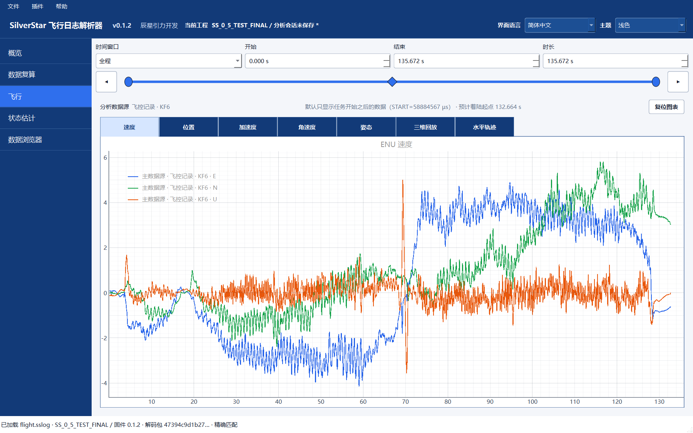
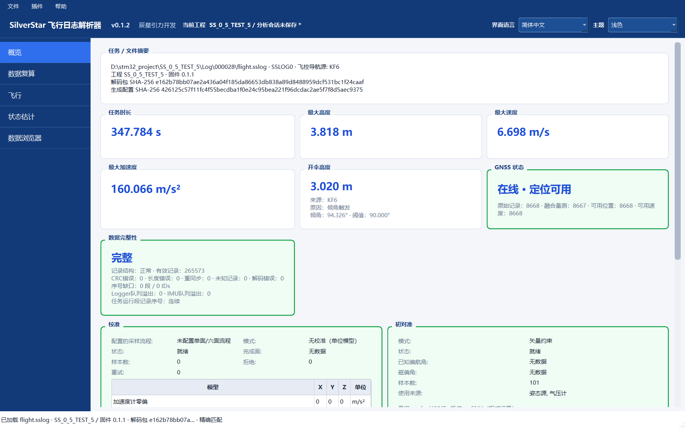

# v0.1.2 三工具图解 / Illustrated walkthrough

[中文首页](../../README.md) · [English home](../../README.en.md) · [English](#english) · [下载日志与解码器](examples/README.md)

先完整解压 [v0.1.2 Windows 便携包](https://github.com/aleistercrowleybeast666/SilverStar/releases/tag/v0.1.2)。三个程序共享 `_internal`，请保留目录结构。以下使用正式版的真实界面、已有 FINAL 配置与真实 Recorded 数据，无需连接设备。

## 1. SCG：选择设备与配置导航

打开 SCG，在“飞控设备”选择功能档位、传感器、接口与安装方向；在“导航配置”按项目能力选择数据源，配置校准、初始对准与算法参数。示例打开已有 `SS_0_5_TEST_FINAL` 项目。

## 2. SCG：核对硬件与生成入口

“飞控硬件”页显示板卡、MCU、CubeMX 来源和外设资源，以及“生成 / 更新飞控工程”入口。生成时选择自己的可写项目目录；编译与烧录需要另行配置工具链。本图只查看已有 FINAL 配置，没有重新生成或烧录。

## 3. GSHC：飞行页、三维姿态与导航曲线

GSHC 的预飞行页用于查看准备状态与任务操作，飞行页用于监测遥测。设备是否 READY 以实际回报为准，命令 ACK 不代替准备状态。

图中展示正式 v0.1.2 的“飞行”页。左侧三维姿态、当前导航数值与右侧六路 E/N/U 速度/位置曲线来自同一份 `000062` Recorded 数据，窗口约为任务 60–70 秒，当前帧约 69.96 秒；任务事件也按原记录显示。界面保持“未连接地面站”。

离线演示用独立脚本将 FLP 精确解码的 Recorded 值提供给正式版显示模型。日常使用时，GSHC 飞行页从地面遥测接收数据，原始 `.sslog` 的打开与回放在 FLP 中完成；这张图不代表 GSHC 新增了原始日志回放入口。已有 JSONL 会话仍可在“后期处理”导出摘要、数据、图表与姿态动画。

## 4. FLP：主要案例 000062

从[样例页](examples/README.md)下载 `FINAL_000062.zip`，打开 `000062/flight.sslog` 并选择同包的 `SS_0_5_TEST_FINAL.ssdecoder`。正常打开入口确认精确匹配；概览显示 103668 条记录。先选择 **Recorded · KF6**，再进入“飞行”，将时间窗口设为“全程”（约 135.672 秒）。

**水平轨迹**显示 E/N 平面路径，颜色表示相对高度，符号标注任务事件。

**三维回放**将姿态与 ENU 轨迹并列显示。拖动播放滑块，可查看记录时刻的姿态；图中位于显示范围末端，任务时间约 132.664 秒。应用按自身任务/着陆显示规则裁定轨迹终点。

**速度曲线**显示 E/N/U 三轴分量。图中使用全程窗口，便于与轨迹和事件时间对应；缩放或切换时间窗口可查看局部变化。

## 5. FLP：独立历史参考 000028

另行打开 `TEST_5_000028.zip` 中的日志与 `SS_0_5_TEST_5.ssdecoder`，得到 265573 条记录，任务约 347.784 秒。不要使用 FINAL 解码器。原始头标记 0.1.0，而解码包的固件/SCG 字段标记 0.1.1，界面显示后者；[来源清单](examples/recordings/manifest.json)分别保留这些字段。

两例图中均为原始 Recorded 值。离线复算、What-if 和主辅比较是独立分析入口；可按需导出 CSV、图表、三维轨迹 PNG、飞行回放 GIF 及概览/诊断/事件，详见 [FLP 指南](FLP/README.md)。

## 截图与输入来源

SCG/FLP 截图采集于 2026-10-19，GSHC 飞行页更新于 2026-10-20。使用正式 v0.1.2 程序文件；本次另将 GSHC 的 35 个分发文件与发布 ZIP 逐字节核对一致。Windows Qt 后端在独立、不在桌面显示的窗口中调用正式版 OpenGL 渲染器；图片均为实际控件截图，仅作无损 PNG 压缩，没有重绘界面或编造导航值。

SCG 只读取 FINAL 配置；GSHC 保持未连接，离线显示模型使用 `000062` 的记录值；FLP 通过正常日志/解码器入口精确打开原始输入，没有执行复算。本次六条曲线的 223 个显示样本逐点核对原始 Recorded 数组，原始文件哈希前后一致。历史台架、手持和抛体记录不构成火箭飞行验证；图中的任务事件不等于真实火箭开伞试验。

## English

Extract the complete [v0.1.2 Windows package](https://github.com/aleistercrowleybeast666/SilverStar/releases/tag/v0.1.2), keeping its shared `_internal` directory. These actual release interfaces, existing FINAL configuration, and real Recorded inputs can be explored without a connected device. The screenshots above use Simplified Chinese.

### 1. SCG: devices and navigation

In Devices, choose the configuration tier, sensors, interfaces, and mounting directions. In Navigation, select sources according to project capabilities and configure calibration, initial alignment, and algorithm parameters. The first two images show the existing `SS_0_5_TEST_FINAL` project.

### 2. SCG: hardware and generation

The third image shows the board, MCU, CubeMX provenance, peripheral resources, and Generate/Update Flight project entry point. Select your own writable project folder when generating; compilation and flashing need separately configured tools. The capture only inspects FINAL and performs neither generation nor flashing.

### 3. GSHC: Flight page, 3D attitude, and navigation curves

Preflight displays readiness and mission operations; Flight monitors telemetry. READY follows actual device reports, and a command ACK does not replace readiness.

The image shows the official v0.1.2 Flight page. The 3D attitude, current navigation values, and six E/N/U velocity/position curves come from the same `000062` Recorded dataset. The window covers about 60–70 mission seconds, with the current frame at about 69.96 seconds; mission events also follow the original recording. The application remains disconnected.

An independent offline demonstration script supplies FLP's exactly decoded Recorded values to the released display model. Normal GSHC Flight operation receives ground telemetry, while original `.sslog` opening and replay belong to FLP; this image does not establish a new GSHC raw-log replay entry point. Existing JSONL sessions can still be exported as summaries, data, charts, and attitude animations in Post-processing.

### 4. FLP: main example 000062

Download `FINAL_000062.zip` from the [sample page](examples/README.md#english), open `000062/flight.sslog`, and select the included `SS_0_5_TEST_FINAL.ssdecoder`. Normal opening confirms an exact match and 103668 records. Select **Recorded · KF6**, open Flight, and choose Full (about 135.672 seconds).

Horizontal trajectory shows the E/N path, relative height as color, and mission-event markers. 3D replay places attitude alongside the ENU path; drag the slider to inspect recorded poses. The image is at the displayed range's end, about 132.664 mission seconds, following the application's mission/landing display rules. The velocity chart shows E/N/U components across the full window; zoom or select a shorter range for local detail.

### 5. FLP: independent reference 000028

Open the separate log and `SS_0_5_TEST_5.ssdecoder` in `TEST_5_000028.zip`: 265573 records, about 347.784 seconds. Do not use FINAL's decoder. The original header identifies 0.1.0; the decoder's firmware/SCG fields identify 0.1.1, which the UI displays. The [provenance manifest](examples/recordings/manifest.json) preserves them separately. Its Overview and full-mission velocity images appear above.

Both cases show original Recorded values. Offline recomputation, What-if, and primary/secondary comparison are separate analysis workflows. Export CSV, charts, 3D-trajectory PNGs, flight-replay GIFs, and overview/diagnostic/event information as needed; see the [FLP guide](FLP/README.md).

### Capture and input provenance

SCG/FLP images were captured on 2026-10-19; the GSHC Flight image was updated on 2026-10-20. All use official v0.1.2 program files; this update separately verified all 35 GSHC distribution files against the published ZIP byte for byte. Windows Qt used the released OpenGL renderer in independent windows configured not to appear on the desktop. These are actual widget captures, compressed losslessly without redrawing the interface or inventing navigation values.

SCG only reads FINAL; GSHC remains disconnected and its offline display model uses `000062` recorded values; FLP opens the exact original inputs through its normal entry point without recomputation. Each of the 223 samples in the six curves was checked against the immutable Recorded arrays, and input hashes are unchanged. Historical bench, handheld, and thrown-object recordings are not rocket flight validation, and recorded mission markers do not establish real rocket deployment tests.
