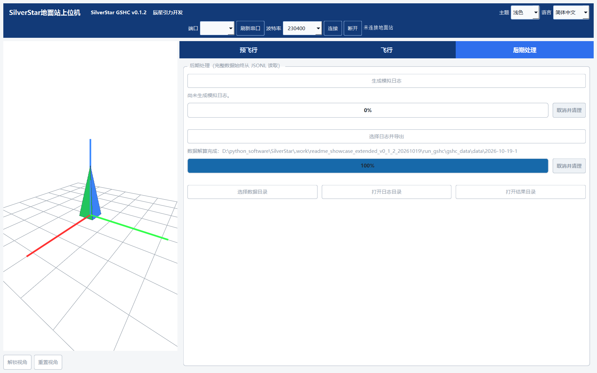

# v0.1.2 三工具图解 / Illustrated walkthrough

[中文首页](../../README.md) · [English home](../../README.en.md) · [English](#english) · [下载日志与解码器](examples/README.md)

先完整解压 [v0.1.2 Windows 便携包](https://github.com/aleistercrowleybeast666/SilverStar/releases/tag/v0.1.2)。三个程序共享 `_internal`，请保留目录结构。以下使用正式版的真实界面、已有 FINAL 配置与真实 Recorded 数据，无需连接设备。

## 1. SCG：选择设备与配置导航

打开 SCG，在“飞控设备”选择功能档位、传感器、接口与安装方向；在“导航配置”按项目能力选择数据源，配置校准、初始对准与算法参数。示例打开已有 `SS_0_5_TEST_FINAL` 项目。

## 2. SCG：核对硬件与生成入口

“飞控硬件”页显示板卡、MCU、CubeMX 来源和外设资源，以及“生成 / 更新飞控工程”入口。生成时选择自己的可写项目目录；编译与烧录需要另行配置工具链。本图只查看已有 FINAL 配置，没有重新生成或烧录。

## 3. GSHC：三维模型与历史会话导出

GSHC 的预飞行页用于查看准备状态与任务操作，飞行页用于监测遥测。设备是否 READY 以实际回报为准，命令 ACK 不代替准备状态。

无需硬件时，可在“后期处理”选择已有 JSONL，会话数据可导出为摘要、数据、图表和姿态动画。图中读取 v0.1.2 标签里已公开的历史 TEST_5 会话，完成摘要、处理后数据与会话清单导出。左侧模型是正式版真实 OpenGL 渲染，保持未连接时的默认姿态；没有把历史日志注入实时链路。

## 4. FLP：主要案例 000062

从[样例页](examples/README.md)下载 `FINAL_000062.zip`，打开 `000062/flight.sslog` 并选择同包的 `SS_0_5_TEST_FINAL.ssdecoder`。正常打开入口确认精确匹配；概览显示 103668 条记录。先选择 **Recorded · KF6**，再进入“飞行”，将时间窗口设为“全程”（约 135.672 秒）。

**水平轨迹**显示 E/N 平面路径，颜色表示相对高度，符号标注任务事件。

**三维回放**将姿态与 ENU 轨迹并列显示。拖动播放滑块，可查看记录时刻的姿态；图中位于显示范围末端，任务时间约 132.664 秒。应用按自身任务/着陆显示规则裁定轨迹终点。

**速度曲线**显示 E/N/U 三轴分量。图中使用全程窗口，便于与轨迹和事件时间对应；缩放或切换时间窗口可查看局部变化。

## 5. FLP：独立历史参考 000028

另行打开 `TEST_5_000028.zip` 中的日志与 `SS_0_5_TEST_5.ssdecoder`，得到 265573 条记录，任务约 347.784 秒。不要使用 FINAL 解码器。原始头标记 0.1.0，而解码包的固件/SCG 字段标记 0.1.1，界面显示后者；[来源清单](examples/recordings/manifest.json)分别保留这些字段。

两例图中均为原始 Recorded 值。离线复算、What-if 和主辅比较是独立分析入口；可按需导出 CSV、图表、三维轨迹 PNG、飞行回放 GIF 及概览/诊断/事件，详见 [FLP 指南](FLP/README.md)。

## 截图与输入来源

截图采集于 2026-10-19，所用 323 个 Python 程序文件与正式 v0.1.2 ZIP 逐字节一致。Windows Qt 后端在独立、不在桌面显示的窗口中调用正式版 OpenGL 渲染器，九张图均为实际控件截图、仅作无损 PNG 压缩，没有重绘或伪造数据。此前 Qt offscreen 后端不支持 OpenGL，故本页改用可创建有效上下文的 Windows 后端。

SCG 只读取 FINAL 配置；GSHC 保持未连接、仅离线导出；FLP 通过正常日志/解码器入口精确打开两组原始输入，没有执行复算。原始文件哈希前后一致。历史台架、手持和抛体记录不构成火箭飞行验证；图中的任务事件不等于真实火箭开伞试验。

## English

Extract the complete [v0.1.2 Windows package](https://github.com/aleistercrowleybeast666/SilverStar/releases/tag/v0.1.2), keeping its shared `_internal` directory. These actual release interfaces, existing FINAL configuration, and real Recorded inputs can be explored without a connected device. The screenshots above use Simplified Chinese.

### 1. SCG: devices and navigation

In Devices, choose the configuration tier, sensors, interfaces, and mounting directions. In Navigation, select sources according to project capabilities and configure calibration, initial alignment, and algorithm parameters. The first two images show the existing `SS_0_5_TEST_FINAL` project.

### 2. SCG: hardware and generation

The third image shows the board, MCU, CubeMX provenance, peripheral resources, and Generate/Update Flight project entry point. Select your own writable project folder when generating; compilation and flashing need separately configured tools. The capture only inspects FINAL and performs neither generation nor flashing.

### 3. GSHC: 3D model and historical session export

Preflight displays readiness and mission operations; Flight monitors telemetry. READY follows actual device reports, and a command ACK does not replace readiness.

For hardware-free use, select an existing JSONL file in Post-processing and export summaries, data, charts, or attitude animations. The image shows successful summary, processed-data, and session-manifest export of a historical TEST_5 session already public in the v0.1.2 tag. The released OpenGL renderer draws the model on the left in its default disconnected pose. Historical log records were not injected into the live link.

### 4. FLP: main example 000062

Download `FINAL_000062.zip` from the [sample page](examples/README.md#english), open `000062/flight.sslog`, and select the included `SS_0_5_TEST_FINAL.ssdecoder`. Normal opening confirms an exact match and 103668 records. Select **Recorded · KF6**, open Flight, and choose Full (about 135.672 seconds).

Horizontal trajectory shows the E/N path, relative height as color, and mission-event markers. 3D replay places attitude alongside the ENU path; drag the slider to inspect recorded poses. The image is at the displayed range's end, about 132.664 mission seconds, following the application's mission/landing display rules. The velocity chart shows E/N/U components across the full window; zoom or select a shorter range for local detail.

### 5. FLP: independent reference 000028

Open the separate log and `SS_0_5_TEST_5.ssdecoder` in `TEST_5_000028.zip`: 265573 records, about 347.784 seconds. Do not use FINAL's decoder. The original header identifies 0.1.0; the decoder's firmware/SCG fields identify 0.1.1, which the UI displays. The [provenance manifest](examples/recordings/manifest.json) preserves them separately. Its Overview and full-mission velocity images appear above.

Both cases show original Recorded values. Offline recomputation, What-if, and primary/secondary comparison are separate analysis workflows. Export CSV, charts, 3D-trajectory PNGs, flight-replay GIFs, and overview/diagnostic/event information as needed; see the [FLP guide](FLP/README.md).

### Capture and input provenance

The screenshots were captured on 2026-10-19 from 323 Python program files that match the official v0.1.2 ZIP byte for byte. Windows Qt used the released OpenGL renderer in independent windows configured not to appear on the desktop. All nine images are actual widget captures, compressed losslessly without redrawing or fabricated data. The earlier Qt offscreen backend lacked OpenGL support; the current Windows backend creates valid contexts.

SCG only reads FINAL; GSHC remains disconnected and exports offline; FLP opens both exact original pairs through its normal entry point without recomputation. Input hashes are unchanged. Historical bench, handheld, and thrown-object recordings are not rocket flight validation, and recorded mission markers do not establish real rocket deployment tests.
