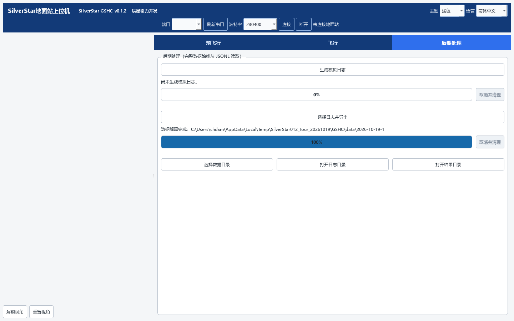
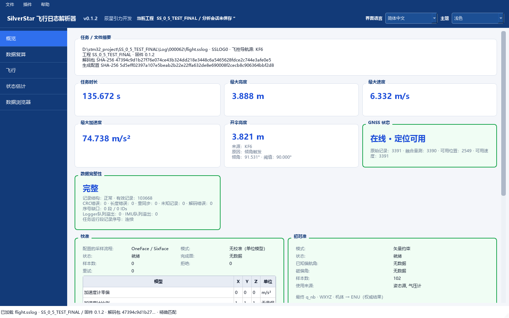
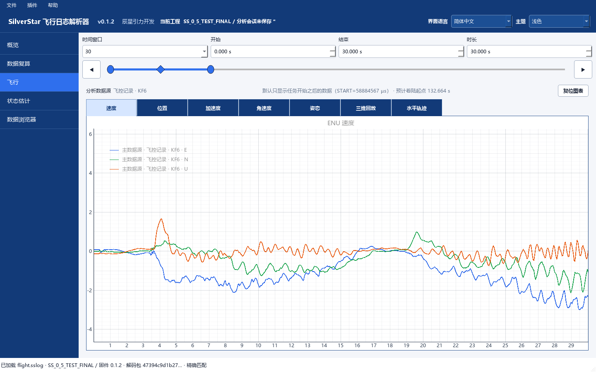

# v0.1.2 三工具图解

[中文首页](../../README.md) · [English](#english) · [下载 v0.1.2](https://github.com/aleistercrowleybeast666/SilverStar/releases/tag/v0.1.2)

## 1. 从配置到日志分析

SCG 负责配置设备、导航与硬件，生成 Flight/Ground 工程及匹配解码包；GSHC 负责地面遥测和会话日志；FLP 用原始飞控日志与精确解码包进行离线分析。首次体验可完整解压 Windows 便携包，分别打开三个程序，无需另装 Python。

本页使用正式 **v0.1.2** 分发中的程序文件，截图于 2026-10-19 通过真实 Qt 控件**离屏捕获**。SCG/FLP 使用已有 FINAL 项目和记录 `000062`；GSHC 使用独立的历史 TEST_5 会话。没有连接设备，也没有将不同来源的数据拼成同一次采集。

## 2. SCG：打开项目，查看配置

1. 在 SCG 打开已有项目的 `SilverStar.ssproject`。图中为 `SS_0_5_TEST_FINAL`。
2. 查看飞控设备、导航配置、遥测和两侧硬件资源。配置值来自实际项目，图中显示其导航源、校准流程和初始对准设置。
3. 需要生成时，选择独立的可写工程目录，按[构建指南](SCG/BUILD.md)准备工具链。本页只打开和浏览既有配置，没有重新生成或烧录该项目。

## 3. GSHC：离线处理会话日志

GSHC 的后期处理读取 **JSONL 会话日志**，与 FLP 使用的 `.sslog` 飞控日志分工不同。

1. 可先下载已保存在 v0.1.2 源码标签中的[历史 TEST_5 会话 JSONL](https://raw.githubusercontent.com/aleistercrowleybeast666/SilverStar/v0.1.2/docs/evidence/test5_gshc_dap_20261008/test5/userdata/logs/fc_session_20261008_151914_726460_01.jsonl)。它包含实际保存的遥测记录，无需重新采集。
2. 打开 GSHC 的“后期处理”，选择“选择日志并导出”，选定该文件。
3. 本例选择摘要、处理后数据和会话信息，完成后查看输出目录。输出位置可自行选择，图中是独立的临时示例目录。

此处没有使用“生成模拟日志”。在线遥测需要匹配的地面站；设备准备情况以实际状态为准，ACK 不等于 READY。

## 4. FLP：精确打开，阅读 Recorded

1. 打开原始 `.sslog` / `.BIN`，选择该次生成对应的 `.ssdecoder`。截图使用 FINAL 的 `000062/flight.sslog` 与 `SS_0_5_TEST_FINAL.ssdecoder`，经正常打开入口确认精确匹配。
2. 先选择 **Recorded**，检查概览中的身份、完整性和任务摘要。本例正常读取 103668 条记录。
3. 切换到“飞行”，按真实时间轴查看速度、位置和其他通道；用时间范围选择器定位关心的片段。第二张图显示任务开始后前 30 秒的 ENU 速度。

Recorded 是原日志记录值，本页没有运行离线复算。`000028` 是 TEST_5 的独立历史参考，应使用其自身解码包，不能与 FINAL 解码包互换。没有上述原始案例文件时，可用[公开台架样例 000044/000045](examples/README.md)体验同样的精确打开流程。源日志和解码包保持只读，导出写入新目录。

## 截图与步骤依据

- 程序版本为 v0.1.2，所用 323 个 Python 程序文件与正式便携 ZIP 逐字节核对一致；没有从 0.1.3 开发界面取图。
- 三款工具均独立离线运行，截图为实际 Qt 控件的离屏输出，采用无损 PNG 压缩；未重绘界面或补造数据。界面文字为简体中文。
- SCG 成功载入 FINAL；GSHC 正常处理公开历史会话并完成所选三类导出；FLP 经 `LogOpenCoordinator` 得到 `exact_generation_profile`，选择 `recorded:kf6`。输入文件哈希在处理前后相同。
- 图中的台架、手持与抛体记录保留其历史范围，不是新增火箭飞行验证。实时连接、控制、烧录和生成固件不在本页已执行步骤内。

## English

[English home](../../README.en.md)

### 1. Configuration to log analysis

SCG configures devices, navigation, and hardware, and generates Flight/Ground projects and matching decoders. GSHC handles ground telemetry and session logs. FLP analyzes original flight-controller logs with their exact decoders. Extract the complete v0.1.2 Windows package to try the three applications without installing Python separately.

These screenshots use program files from the official **v0.1.2** distribution, captured from real Qt widgets **offscreen** on 2026-10-19. SCG/FLP use the existing FINAL project and record `000062`; GSHC uses an independent historical TEST_5 session. No devices were connected, and these separate inputs are not presented as one acquisition session. The screenshots above use Simplified Chinese.

### 2. SCG: open and inspect a project

Open `SilverStar.ssproject`; the example is `SS_0_5_TEST_FINAL`. Inspect devices, navigation, telemetry, and hardware resources. The screenshot shows the project's actual navigation sources, calibration workflow, and initial alignment settings. If you generate a project yourself, choose a separate writable output directory and follow the [build guide](SCG/BUILD.md). This walkthrough opens the existing configuration without regenerating or flashing it.

### 3. GSHC: process an existing session offline

GSHC post-processing reads **JSONL session logs**; FLP reads `.sslog` flight-controller logs. Download the [historical TEST_5 JSONL](https://raw.githubusercontent.com/aleistercrowleybeast666/SilverStar/v0.1.2/docs/evidence/test5_gshc_dap_20261008/test5/userdata/logs/fc_session_20261008_151914_726460_01.jsonl), already public in the v0.1.2 source tag. In Post-processing, select the log and export. This example exports the summary, processed data, and session information. Choose any writable output location; the screenshot shows an isolated temporary example folder.

The existing log was processed successfully without generating simulated data. Live telemetry requires a matching ground station; readiness follows actual device state, and an ACK does not mean READY.

### 4. FLP: exact opening and Recorded data

Open an original `.sslog` / `.BIN` and select its exact `.ssdecoder`. The example pairs FINAL's `000062/flight.sslog` with `SS_0_5_TEST_FINAL.ssdecoder` through the normal opening path. Select **Recorded** first, check identity and integrity in Overview, then inspect channels on the Flight page using the real time axis. The example opens 103668 records; the chart above shows ENU velocity during the first 30 seconds after mission start.

Recorded means values actually recorded; this walkthrough does not run recomputation. Historical record `000028` belongs to TEST_5 and requires its own decoder, which must not be exchanged with FINAL's. Without those original case files, use the [public bench pairs 000044/000045](examples/README.md#english) to try the same exact-opening workflow. Preserve the inputs and export into a new folder.

### Capture and verification scope

The 323 Python program files used match the official v0.1.2 ZIP byte for byte. All three applications ran independently offline; the images are losslessly compressed captures of their actual Qt widgets, with no redrawn UI or fabricated data. SCG loaded FINAL, GSHC completed its three selected export types, and FLP opened `000062` as `exact_generation_profile` with `recorded:kf6` selected. Input hashes were unchanged. These historical bench, handheld, and thrown-object recordings are not new rocket flight validation; live connections, control, flashing, and firmware generation were not performed.
